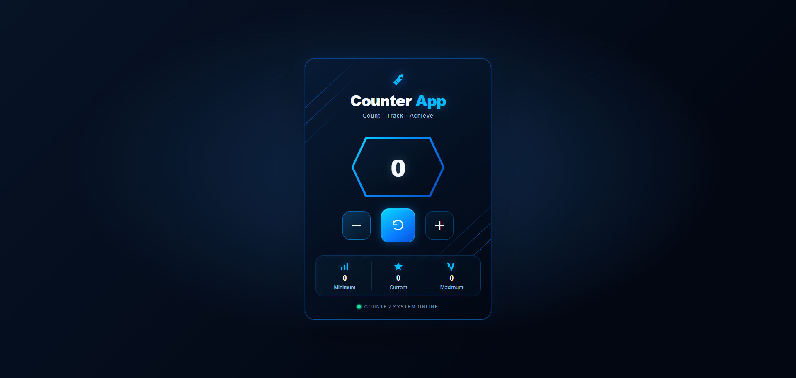

<!-- # React + Vite

This template provides a minimal setup to get React working in Vite with HMR and some ESLint rules.

Currently, two official plugins are available:

- [@vitejs/plugin-react](https://github.com/vitejs/vite-plugin-react/blob/main/packages/plugin-react) uses [Oxc](https://oxc.rs)
- [@vitejs/plugin-react-swc](https://github.com/vitejs/vite-plugin-react/blob/main/packages/plugin-react-swc) uses [SWC](https://swc.rs/)

## React Compiler

The React Compiler is not enabled on this template because of its impact on dev & build performances. To add it, see [this documentation](https://react.dev/learn/react-compiler/installation).

## Expanding the ESLint configuration

If you are developing a production application, we recommend using TypeScript with type-aware lint rules enabled. Check out the [TS template](https://github.com/vitejs/vite/tree/main/packages/create-vite/template-react-ts) for information on how to integrate TypeScript and [`typescript-eslint`](https://typescript-eslint.io) in your project. -->


# ⚛️ React + Vite

A modern React development setup powered by Vite, featuring fast Hot Module Replacement (HMR) and ESLint for code quality.

<p align="center">
  
  &nbsp;&nbsp;&nbsp;
  
</p>

<p align="center">
  <strong>Build modern web applications with React and Vite.</strong>
</p>

---

## 📸 Project Preview

Add a screenshot of your application to the repository and name it `screenshot.png` inside a folder named `screenshots`.

<p align="center">
  
</p>

> Replace the example screenshot with an actual screenshot of your project.

## 🚀 Features

- ⚛️ React for building interactive user interfaces
- ⚡ Vite for fast development and optimized builds
- 🔥 Hot Module Replacement (HMR)
- 🧹 ESLint for code quality and consistency
- 🧩 Support for official React plugins

## 🛠️ Technologies Used

- React
- Vite
- JavaScript
- HTML5
- CSS3
- ESLint

## 📦 Getting Started

### Prerequisites

Install [Node.js](https://nodejs.org/) and npm before starting.

### Installation

**1. Clone the repository**

```bash
git clone YOUR_REPOSITORY_URL
```

**2. Navigate to the project folder**

```bash
cd YOUR_PROJECT_FOLDER
```

**3. Install dependencies**

```bash
npm install
```

**4. Start the development server**

```bash
npm run dev
```

Open the local URL shown in your terminal to view the application.

## 🧩 Official React Plugins

Two official Vite React plugins are available:

- [`@vitejs/plugin-react`](https://github.com/vitejs/vite-plugin-react/tree/main/packages/plugin-react) — uses Oxc for its transform pipeline.
- [`@vitejs/plugin-react-swc`](https://github.com/vitejs/vite-plugin-react/tree/main/packages/plugin-react-swc) — uses SWC.

Choose the plugin that best suits your project's requirements.

## ⚙️ React Compiler

The React Compiler is not enabled by default in this template because it can affect development and build performance.

To learn how to enable it, see the [React Compiler installation guide](https://react.dev/learn/react-compiler/installation).

## 🧹 ESLint Configuration

For production applications, consider TypeScript with type-aware lint rules.

- [React + TypeScript Vite template](https://github.com/vitejs/vite/tree/main/packages/create-vite/template-react-ts)
- [typescript-eslint documentation](https://typescript-eslint.io/)

## 🏗️ Build for Production

Create an optimized production build:

```bash
npm run build
```

Preview the production build locally:

```bash
npm run preview
```

## 📁 Project Structure

```text
your-project/
├── public/
├── screenshots/
│   └── screenshot.png
├── src/
│   ├── assets/
│   ├── App.jsx
│   ├── App.css
│   └── main.jsx
├── index.html
├── package.json
└── README.md
```

*Your actual folder structure may differ.*

## 📄 License

This project is available for learning and development. Add a license file if you intend to distribute it under a specific license.

---

<p align="center">
  Made with ❤️ using React and Vite
</p>