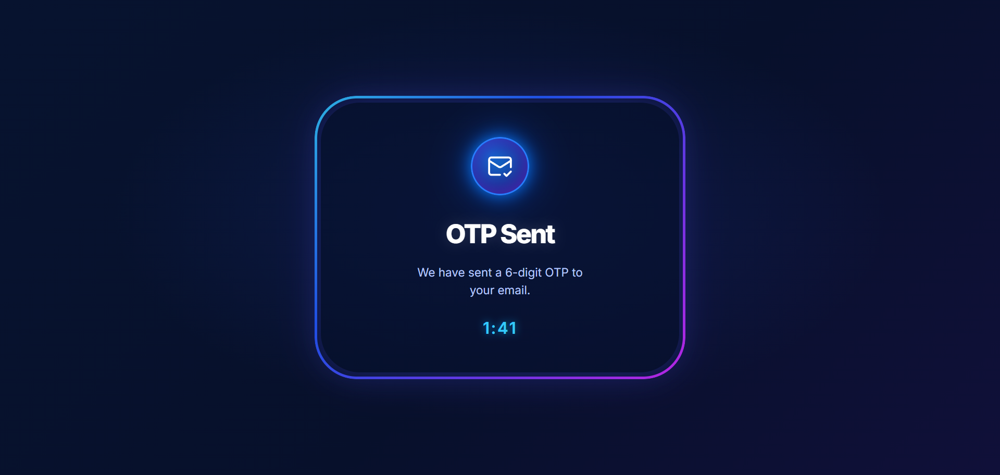

 
<p align="center">
  
</p>

<h3 align="center">
  
</h3>

<p align="center">
  A modern and responsive OTP timer application featuring a neon-inspired glassmorphism interface, countdown timer, resend functionality, and attempt restrictions.
</p>

<p align="center">
  
  
  
  
  
</p>

---

## ✨ About The Project

**OTP Timer App** is a React-based frontend project that demonstrates OTP countdown functionality and resend attempt management.

It features a premium dark interface with glowing blue-purple gradients, animated elements, glass effects, and smooth transitions.

The application starts a 2-minute countdown and allows users to resend OTP after the timer expires. It also limits resend attempts and temporarily blocks further attempts after the maximum limit is reached.

## 🖥️ Project Preview

<p align="center">
  
</p>

## 🚀 Features

- **OTP Countdown:** Starts with a 2-minute countdown.
- **Live Timer:** Updates the remaining time every second.
- **Resend OTP:** Enables resend functionality when the timer expires.
- **Loading Animation:** Displays an animated loader while resending OTP.
- **Maximum Attempts:** Allows only 3 successful resend attempts.
- **1-Hour Restriction:** Blocks further attempts after reaching the limit.
- **Toast Notifications:** Displays success and error notifications.
- **Glassmorphism UI:** Transparent glass-style notification design.
- **Neon Effects:** Blue and purple glowing borders and elements.
- **Responsive Design:** Supports desktop, tablet, and mobile screens.

## 🛠️ Technologies Used

| Technology | Purpose |
|---|---|
| React.js | UI development |
| JavaScript | Application logic |
| CSS3 | Styling and animations |
| Vite | Development environment |
| Lucide React | Icons |
| React Toastify | Notifications |

## ⚙️ How It Works

1. The OTP screen initially displays a 2-minute countdown.
2. The countdown decreases every second.
3. When the timer reaches zero, the Resend OTP option appears.
4. Clicking Resend OTP displays a loading animation for 2 seconds.
5. After successful resend, the timer restarts at 2 minutes.
6. Users can successfully resend OTP a maximum of 3 times.
7. On the next attempt, a notification appears and a 1-hour restriction starts.
8. After the restriction expires, the resend count resets.

**Note:** This is a frontend practice project. Timer, attempt count, and lock state are maintained using React state, so refreshing the page resets them. Real OTP verification and security restrictions require backend implementation.

## 📚 React Concepts Practiced

- `useState()` – Managing timer, loading state, resend attempts, and lock countdown.
- `useEffect()` – Managing countdown intervals.
- `setInterval()` – Updating the timer.
- `clearInterval()` – Cleaning up intervals.
- `setTimeout()` – Handling resend loading duration.
- Conditional Rendering – Displaying timer, loader, and resend button.
- Event Handling – Managing resend button clicks.
- React Toastify – Displaying notifications.

## 📂 Project Structure

```text
OTP-Timer-App/
│
├── public/
│
├── src/
│   ├── assets/
│   │   └── image/
│   │       └── otp-timer.png
│   │
│   ├── App.jsx
│   ├── index.css
│   └── main.jsx
│
├── index.html
├── package.json
├── package-lock.json
└── README.md
```

## 💻 Installation & Setup

**1. Clone the repository**

```bash
git clone https://github.com/Drash011/ReactVerse.git
```

**2. Navigate to the project folder**

```bash
cd ReactVerse/OTP-Timer-App
```

**3. Install dependencies**

```bash
npm install
```

**4. Install required packages if they are not already listed**

```bash
npm install lucide-react react-toastify
```

**5. Start the development server**

```bash
npm run dev
```

## 🎯 Learning Outcomes

Through this project, I practiced React state management, timer functionality, conditional rendering, event handling, loading states, and notification handling.

It also helped me understand how to create attractive interfaces using CSS gradients, animations, glowing effects, and glassmorphism.

## 👩‍💻 Author

**Drashti Thummar**

Full Stack Developer | React.js Learner

<p align="center">
  <a href="https://github.com/Drash011">
    
  </a>
  <a href="https://github.com/Drash011/ReactVerse">
    
  </a>
</p>

---

<p align="center">
  ⭐ If you like this project, consider giving the repository a star!
</p>

<p align="center">
  
</p>

