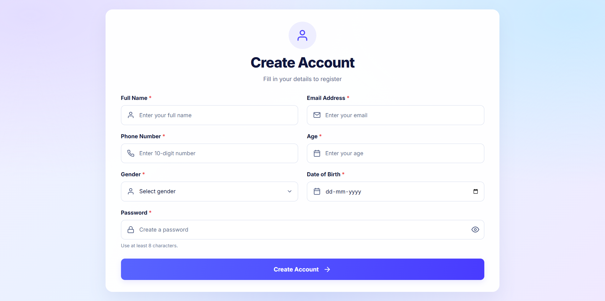
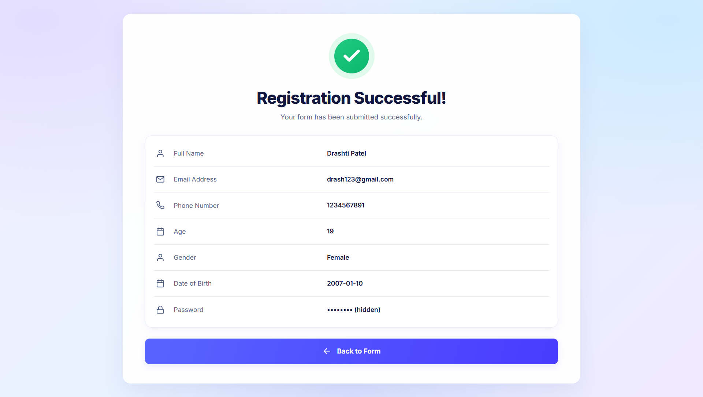

# 🚀 React Form & Details

A modern, responsive web application built with **React.js** and **Vite**. Users can enter their information into a form, submit it, and view their submitted details in a clean and organized interface.

## 📸 Screenshots

### 1. Form Interface

The initial screen allows users to enter their information using a simple and user-friendly form.



### 2. Submitted Details

After successful submission, the form hides and the submitted information is displayed on the screen.



## ✨ Features

- 📝 Interactive form for collecting user information
- ⚛️ Built with React functional components and hooks
- 🔄 Dynamic UI updates after form submission
- 👤 Displays submitted user details
- 📱 Responsive and user-friendly interface
- ⚡ Fast development with Vite
- 🔥 Hot Module Replacement (HMR)
- 🧹 ESLint support for code quality

## 🛠️ Technologies Used

| Technology | Purpose |
|---|---|
| React.js | Building the user interface |
| Vite | Development server and build tool |
| JavaScript | Application logic and interactivity |
| HTML5 | Application structure |
| CSS3 | Styling and responsive design |
| ESLint | Code quality and linting |
| Git & GitHub | Version control and project hosting |

## 📂 Project Structure

```text
react-form-details/
├── public/
├── src/
│   ├── assets/
│   ├── App.jsx
│   ├── App.css
│   ├── index.css
│   └── main.jsx
├── screenshots/
│   ├── form.png
│   └── details.png
├── index.html
├── package.json
├── package-lock.json
├── vite.config.js
├── eslint.config.js
└── README.md
```

*Note: Your actual file and folder names may differ.*

## ⚙️ Installation and Setup

Follow these steps to run the project locally.

### Prerequisites

Make sure you have installed:

- [Node.js](https://nodejs.org/)
- npm (included with Node.js)
- [Git](https://git-scm.com/) (optional, for cloning the repository)

Check your installed versions:

```bash
node -v
npm -v
```

### Step 1: Clone the Repository

Replace `YOUR_USERNAME` and `YOUR_REPOSITORY` with your GitHub username and repository name.

```bash
git clone https://github.com/Drash011/ReactVerse.git
```

### Step 2: Navigate to the Project Folder

```bash
cd ReactVerse
```

### Step 3: Install Dependencies

```bash
npm install
```

### Step 4: Start the Development Server

```bash
npm run dev
```

### Step 5: Open the Application

Open the local URL displayed in your terminal. The default Vite address is usually:

```text
http://localhost:5173
```

## ▶️ Available Commands

| Command | Description |
|---|---|
| `npm run dev` | Starts the development server |
| `npm run build` | Creates a production build |
| `npm run preview` | Previews the production build |
| `npm run lint` | Checks code using ESLint |

## 🔍 How It Works

1. The user opens the application and sees the form.
2. The user enters the required information.
3. The user submits the form.
4. React processes the form submission.
5. The form is hidden, and the submitted details are displayed.

The exact behavior depends on the implementation in your React components.

## 🖼️ How to Add Screenshots

To display your screenshots on GitHub:

1. Create a folder named `screenshots` in the project root.
2. Capture a screenshot of the initial form.
3. Save it as `form.png` inside the `screenshots` folder.
4. Capture a screenshot of the submitted details.
5. Save it as `details.png` inside the same folder.

Make sure the filenames match the image paths in this README.

## 🚀 Production Build

To build the application for production, run:

```bash
npm run build
```

---

If you have not connected your local project to GitHub yet, create a repository on GitHub and follow GitHub's instructions to connect and push your existing project.

## 🔮 Future Improvements

- Add more form fields and validation.
- Improve accessibility.
- Add edit and delete functionality for submitted details.
- Store submitted information using a backend or database.
- Add loading and success messages.

## 🤝 Contributing

Contributions, suggestions, and improvements are welcome.

1. Fork the repository.
2. Create a new branch.
3. Make your changes.
4. Submit a pull request.

---

**Developed with ❤️ using React.js and Vite.**
