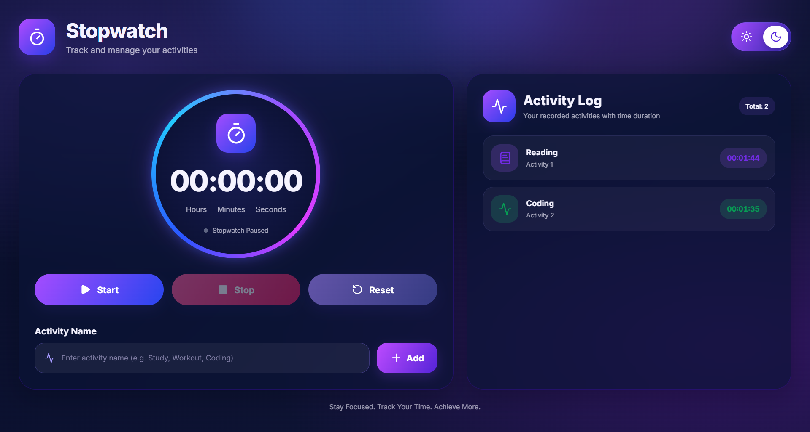
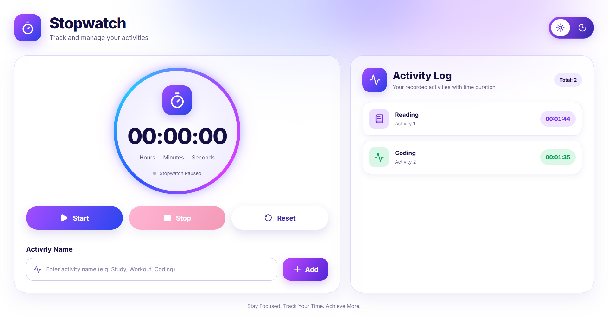

 
<p align="center">
  
</p>

<h3 align="center">
  
</h3>

<p align="center">
  A modern and responsive stopwatch application built with React.js, featuring an animated timer, activity tracking, and beautiful light and dark themes.
</p>

<p align="center">
  
  
  
  
  
</p>

---

## ✨ About The Project

**Stopwatch** is a React.js application designed to track time and manage daily activities with a clean, modern interface.

It includes a stopwatch with Start, Stop, and Reset controls, along with an activity tracking section where users can save completed activities and their time durations.

The application also features a beautiful theme switcher that allows users to move between light and dark modes. Both themes use gradient colors, soft shadows, glowing accents, and smooth visual transitions.

## 🎨 Theme Preview

The application supports two visually different themes.

### 🌙 Dark Theme

<p align="center">
  
</p>

### ☀️ Light Theme

<p align="center">
  
</p>

## 🚀 Features

- **Stopwatch Timer:** Tracks elapsed time in hours, minutes, and seconds.
- **Start:** Starts the stopwatch.
- **Stop:** Pauses the stopwatch without losing the elapsed time.
- **Reset:** Resets the stopwatch to zero.
- **Activity Tracking:** Add activity names with their recorded durations.
- **Activity Log:** Displays all saved activities in a separate panel.
- **Automatic Activity Icons:** Displays different icons based on activity names.
- **Light Theme:** Clean interface with soft gradients and shadows.
- **Dark Theme:** Deep navy background with glowing purple and blue accents.
- **Theme Toggle:** Switch between light and dark modes.
- **Responsive Design:** Adapts to desktop, tablet, and mobile screens.
- **Session-Based Data:** Activity logs are cleared automatically when the page is refreshed.

## 🛠️ Technologies Used

| Technology | Purpose |
|---|---|
| React.js | Component-based UI development |
| JavaScript | Stopwatch and activity logic |
| CSS3 | Styling, gradients, shadows, and animations |
| Vite | Development and build environment |
| Lucide React | Modern interface icons |

## ⚙️ How It Works

1. The stopwatch initially displays `00:00:00`.
2. Click **Start** to begin counting elapsed time.
3. Click **Stop** to pause the timer.
4. Click **Reset** to return the timer to zero.
5. Enter an activity name in the input field.
6. Click **Add** after stopping the timer to save the activity and its duration.
7. The saved activity appears in the Activity Log.
8. Switch between light and dark themes using the theme toggle.
9. Refreshing the page clears the activity log and resets the stopwatch.

## 🧠 React Concepts Practiced

- **useState():** Managing timer values, theme, activity input, activity logs, and running status.
- **useEffect():** Managing the stopwatch interval.
- **setInterval():** Updating the timer every second.
- **clearInterval():** Cleaning up the timer interval.
- **Conditional Rendering:** Displaying different timer states and activity icons.
- **Event Handling:** Managing Start, Stop, Reset, Add, and Theme buttons.
- **Array State Management:** Adding activities to the activity list.
- **Dynamic Styling:** Changing the interface based on the selected theme.

## 📂 Project Structure

```text
Stopwatch/
│
├── public/
│
├── src/
│   ├── assets/
│   │   └── image/
│   │       ├── dark-ss.png
│   │       └── light-ss.png
│   │
│   ├── App.jsx
│   ├── index.css
│   └── main.jsx
│
├── index.html
├── package.json
├── package-lock.json
└── README.md
```

## 💻 Installation & Setup

**1. Clone the repository**

```bash
git clone https://github.com/Drash011/ReactVerse.git
```

**2. Navigate to the Stopwatch project**

```bash
cd ReactVerse/Stopwatch
```

**3. Install dependencies**

```bash
npm install
```

**4. Install Lucide React if it is not already included**

```bash
npm install lucide-react
```

**5. Start the development server**

```bash
npm run dev
```

## 📱 Responsive Design

The application is designed to work across different screen sizes:

- Desktop: Two-column layout with stopwatch and activity log.
- Tablet: Adaptable layout with comfortable spacing.
- Mobile: Single-column layout with responsive timer controls and activity cards.

## 📖 Learning Outcomes

Building this project helped me practice React state management, effects, timer functionality, event handling, conditional rendering, and dynamic CSS styling.

It also helped me understand how to create modern interfaces using gradients, glass-like panels, glowing effects, responsive layouts, and theme switching.

## 🔮 Future Improvements

- Save activity history using localStorage.
- Add individual activity categories.
- Add total time summaries.
- Add activity filtering and search.
- Add downloadable activity reports.

## 👩‍💻 Author

**Drashti Thummar**

Full Stack Developer | React.js Learner

<p align="center">
  <a href="https://github.com/Drash011">
    
  </a>
  <a href="https://github.com/Drash011/ReactVerse">
    
  </a>
</p>

<p align="center">
  <b>Project Repository:</b><br/>
  <a href="https://github.com/Drash011/ReactVerse/tree/main/Stopwatch">Stopwatch – View on GitHub</a>
</p>

---

<p align="center">
  
</p>

