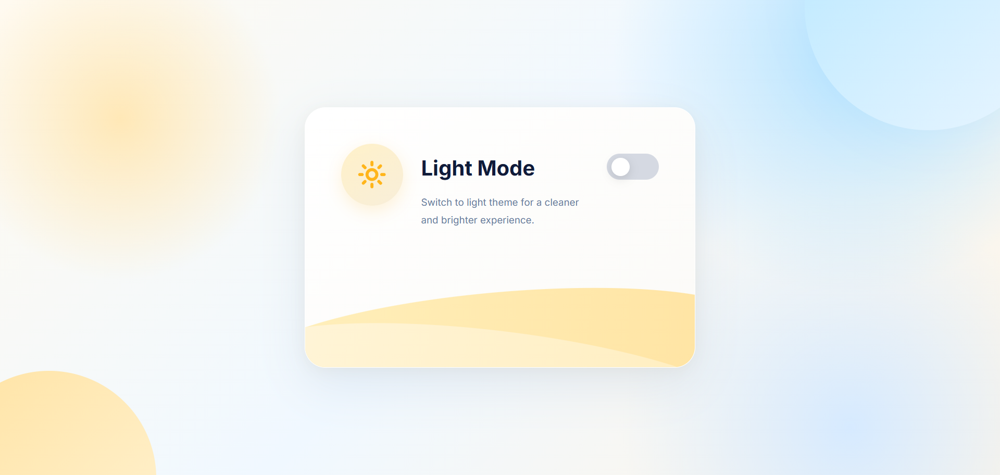
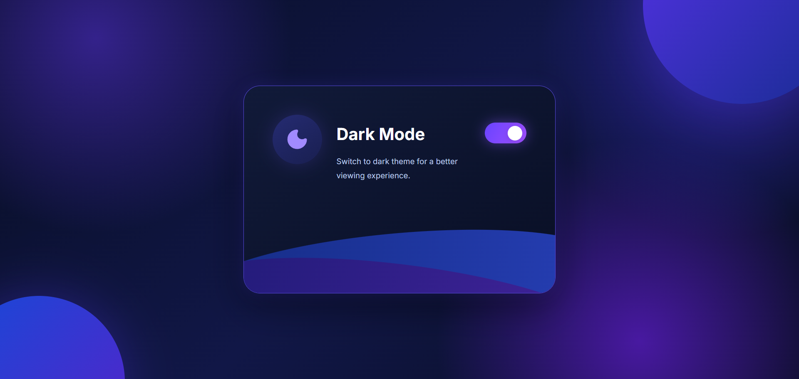

<!-- # React + Vite

This template provides a minimal setup to get React working in Vite with HMR and some ESLint rules.

Currently, two official plugins are available:

- [@vitejs/plugin-react](https://github.com/vitejs/vite-plugin-react/blob/main/packages/plugin-react) uses [Oxc](https://oxc.rs)
- [@vitejs/plugin-react-swc](https://github.com/vitejs/vite-plugin-react/blob/main/packages/plugin-react-swc) uses [SWC](https://swc.rs/)

## React Compiler

The React Compiler is not enabled on this template because of its impact on dev & build performances. To add it, see [this documentation](https://react.dev/learn/react-compiler/installation).

## Expanding the ESLint configuration

If you are developing a production application, we recommend using TypeScript with type-aware lint rules enabled. Check out the [TS template](https://github.com/vitejs/vite/tree/main/packages/create-vite/template-react-ts) for information on how to integrate TypeScript and [`typescript-eslint`](https://typescript-eslint.io) in your project. -->

# ✨ Dark & Light Theme Toggle | React.js

<p align="center">
  
</p>

<p align="center">
  A modern, responsive and animated Dark & Light Mode Theme Switcher built using React.js. Experience beautiful gradients, glowing effects, smooth transitions and persistent theme preferences.
</p>

<p align="center">
  
  
  
  
</p>

---

## 🚀 Live Demo

<p align="center">
  <a href="YOUR_LIVE_WEBSITE_URL">
    
  </a>
</p>

**Live Website:** [Click Here](YOUR_LIVE_WEBSITE_URL)

> Replace `YOUR_LIVE_WEBSITE_URL` with your deployed website URL from Vercel or Netlify.

---

## 🎨 Project Preview

### ☀️ Light Mode

<p align="center">
  
</p>

### 🌙 Dark Mode

<p align="center">
  
</p>

---

## ✨ Features

- ☀️ **Light Mode:** Beautiful cream, sky-blue and golden gradient background.
- 🌙 **Dark Mode:** Premium navy, blue and purple gradient background.
- 🎨 **Modern UI:** Attractive card design with rounded corners and wave effects.
- 🔄 **Smooth Transitions:** Animated theme switching experience.
- 💾 **LocalStorage:** Remembers the selected theme after refreshing the page.
- 📱 **Fully Responsive:** Works on desktop, tablet and mobile devices.
- 💡 **Dynamic Icons:** Sun and moon icons change according to the selected theme.
- ✨ **Gradient Effects:** Beautiful backgrounds, shadows and glowing elements.

---

## 🛠️ Technologies Used

| Technology | Purpose |
|---|---|
| React.js | Component-based UI development |
| JavaScript (ES6+) | Theme switching functionality |
| CSS3 | Styling, gradients and animations |
| React Hooks | State management and side effects |
| LocalStorage | Persistent theme preferences |
| Lucide React | Sun and Moon icons |
| Vite | Development server and build tool |

---

## 📂 Project Structure

```text
Theme-Toggle/
│
├── public/
│
├── screenshots/
│   ├── light.png
│   └── dark.png
│
├── src/
│   ├── App.jsx
│   ├── index.css
│   └── main.jsx
│
├── index.html
├── package.json
├── package-lock.json
└── README.md
```

---

## ⚙️ Installation & Setup

Follow these steps to run the project locally.

**1. Clone the repository**

```bash
git clone YOUR_GITHUB_REPOSITORY_URL
```

**2. Navigate to the project folder**

```bash
cd Theme-Toggle
```

**3. Install dependencies**

```bash
npm install
```

**4. Install Lucide React**

```bash
npm install lucide-react
```

**5. Start the development server**

```bash
npm run dev
```

**6. Open in browser**

```text
http://localhost:5173
```

---

## 🧠 React Concepts Used

This project demonstrates the following React concepts:

**1. useState**

Used to manage the currently selected theme.

```jsx
const [theme, setTheme] = useState(
  localStorage.getItem("theme") || "light"
);
```

**2. useEffect**

Used to save the selected theme in LocalStorage whenever the theme changes.

```jsx
useEffect(() => {
  localStorage.setItem("theme", theme);
}, [theme]);
```

**3. Event Handling**

Used to switch between Light Mode and Dark Mode.

```jsx
const changeTheme = () => {
  setTheme(theme === "light" ? "dark" : "light");
};
```

**4. Conditional Rendering**

Used to display the correct icon and theme information.

```jsx
{theme === "light" ? <Sun /> : <Moon />}
```

---

## 🎯 How It Works

1. When the application starts, it checks LocalStorage for the previously selected theme.
2. If no theme is saved, Light Mode is selected by default.
3. When the user clicks the toggle button, the theme changes.
4. The background, card, text, icons and gradients update according to the selected theme.
5. The selected theme is saved in LocalStorage.
6. When the browser is refreshed, the previously selected theme is restored.

---

## 📱 Responsive Design

The application is optimized for different screen sizes.

- Desktop: Centered theme card with full-screen gradient background.
- Tablet: Adjusted card dimensions and spacing.
- Mobile: Flexible layout with responsive typography and controls.

---

## 🔮 Future Improvements

- [ ] Add more theme color combinations.
- [ ] Add custom theme selection.
- [ ] Add theme transition animations.
- [ ] Add system preference detection.
- [ ] Add more background styles.

---

## 👩‍💻 Author

<p align="center">
  <b>Drashti Thummar</b>
  <br/>
  Full Stack Developer | React.js Learner
  <br/><br/>
  <a href="YOUR_GITHUB_PROFILE_URL">
    
  </a>
</p>

---

<p align="center">
  ⭐ If you like this project, don't forget to give it a star!
  <br/><br/>
  <b>Made with ❤️ using React.js</b>
</p>