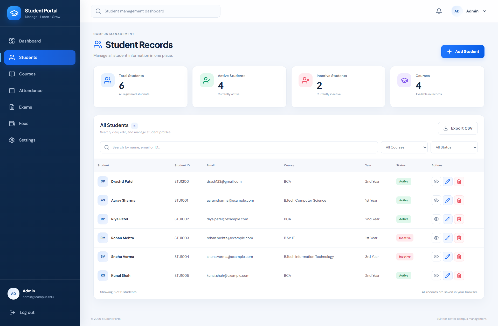

# ⚛️ ReactVerse

### My React JS Learning & Project Collection

Welcome to **ReactVerse** — a collection of React JS practice projects and web development experiments created while learning and improving frontend development skills.

<p align="center">
  <a href="https://github.com/Drash011/ReactVerse">
    
  </a>
  <a href="https://github.com/Drash011/ReactVerse/tree/main/student-record-system">
    
  </a>
</p>

---

## 👩‍💻 About Me

**Drashti Thummar**

- GitHub Profile: [@Drash011](https://github.com/Drash011)
- Main Repository: [ReactVerse](https://github.com/Drash011/ReactVerse)
- Featured Project: [Student Record System](https://github.com/Drash011/ReactVerse/tree/main/student-record-system)

I'm practicing React JS and building projects to strengthen my programming, component development, and frontend skills.

---

## 🚀 Featured Project

### 🎓 Student Record System

A project maintained within the ReactVerse repository.

**Project Links**

- [View Source Code](https://github.com/Drash011/ReactVerse/tree/main/student-record-system)
- [Explore Main Repository](https://github.com/Drash011/ReactVerse)

### 🖥️ Project Preview

Add a screenshot of your actual running website to the repository at `student-record-system/assets/student-record-system-preview.png`.



---

## 📂 Repository Projects

| Project | Description | Source Code |
|---|---|---|
| Counter-App | Counter practice project | [View](https://github.com/Drash011/ReactVerse/tree/main/Counter-App) |
| State-Use-Form | State and form practice | [View](https://github.com/Drash011/ReactVerse/tree/main/State-Use-Form) |
| first-component | React component practice | [View](https://github.com/Drash011/ReactVerse/tree/main/first-component) |
| my-first-npx-website | React JS practice project | [View](https://github.com/Drash011/ReactVerse/tree/main/my-first-npx-website) |
| Student Record System | Student record system project | [View](https://github.com/Drash011/ReactVerse/tree/main/student-record-system) |

---

## 🛠️ Technologies

This repository focuses on React JS practice. Check each project's source files and `package.json` to confirm its exact technologies and dependencies.

- React JS
- JavaScript
- HTML5
- CSS3
- npm

---

## 💻 Getting Started

### 1. Clone the repository

```bash
git clone https://github.com/Drash011/ReactVerse.git
```

### 2. Navigate to the repository

```bash
cd ReactVerse
```

### 3. Open the project

```bash
cd student-record-system
```

### 4. Install dependencies

If the project contains a `package.json`, run:

```bash
npm install
```

### 5. Start the development server

Check the project's `package.json` scripts and use the appropriate command. For example:

```bash
npm run dev
```

Use this command only if a `dev` script is configured.

---

## 🎯 Goals

- Practice React JS concepts.
- Improve JavaScript and frontend development skills.
- Build practical projects.
- Learn component-based development.
- Organize and document projects on GitHub.

---

## 🔗 Connect With Me

<p align="center">
  <a href="https://github.com/Drash011">
    
  </a>
  <a href="https://github.com/Drash011/ReactVerse">
    
  </a>
</p>

---

## 📄 License

No license has been verified for this repository. Check the repository for licensing information before reusing or distributing its code.

---

<p align="center">
  <b>Created with ❤️ by Drashti Thummar</b>
  <br />
  <a href="https://github.com/Drash011/ReactVerse">Explore ReactVerse on GitHub</a>
</p>